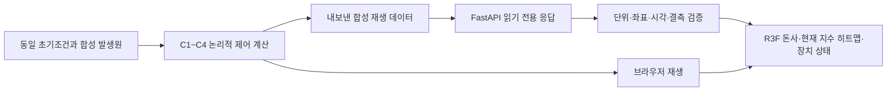
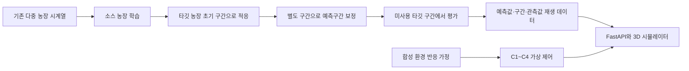

> 보관본: 최신 회의 자료는 [MEETING_BRIEF.md](../../history/MEETING_BRIEF.md)입니다.

# 제안서 반영 초안 — 내부 NH₃ 예측·제어 시뮬레이터

작성 기준: 2026-10-07. 용도: 제안서 작성 및 팀 최종 회의 전 검토. 제출 확정본이 아니며 원본 PDF는 변경하지 않았습니다. 사용자 요청의 최신 범위인 ‘돈사 내부 중심’을 우선합니다. 아래 문장은 복사해 사용할 수 있으나 회의에서 정할 기술·데이터·수치는 확정된 것으로 기재하지 않습니다.

## 1. 아이디어 요약 초안 — 200자 이내

다중 농장 환경 시계열을 활용해 새로운 농장에 적응하는 NH₃ 예측 모델을 개발하고, 예측구간의 실제 포함률과 폭으로 신뢰도를 평가한다. 직접 센서 실측 없이 기존 데이터를 활용하며, 예측 결과와 가상 제어 흐름을 3D 돈사 시뮬레이터에서 재생한다.

## 2. 개발 목적·범위

본 프로젝트는 돈사 내부의 NH₃ 피크를 사전에 예측하고 환기 제어 시점을 판단하는 내부 폐루프 시스템을 목표로 한다. 외부 민가의 위치·지형·실시간 기상에 따른 확산 재현과 하드웨어 축소모형 제작은 개발 범위에서 제외한다. 예측·제어 판단·상태 변화를 확인할 수 있도록 React Three Fiber 기반 3D 돈사 공간과 FastAPI 데이터 인터페이스를 구성한다.

사용자 추가 확정에 따라 주력 기술은 **다중 농장 전이학습과 예측 신뢰도 검증**으로 정한다. 직접 하드웨어 센서를 설치해 새로 실측하는 작업과 실물 장치 제어는 이번 필수 개발 범위에 포함하지 않는다. 기존 공개·제공 데이터의 활용을 전제로 하되 실제 확보 여부와 품질은 별도로 확인한다. 시연은 시뮬레이터로만 진행한다. 비전은 보조 항목이며 동기화 데이터가 없다는 이유로 주력 과제 전체를 중단하지 않는다.

3D 공간은 무창·기계환기·중앙 배기형 사육실의 개념 모형으로 구성한다. 돈방, 관리 통로, 급이·급수 설비, 부분 슬랫과 하부 피트, 입기구, 중앙 덕트, 환기팬, 배기 세정 설비를 표현한다. 치수와 장치 위치는 구현 가정이며 특정 농장을 실측해 복제한 도면은 아니다. 구조 참고 대상과 근거는 [구조 비교 기록](../../history/STRUCTURE_REVIEW.md)에 정리했다.

바닥 히트맵은 데이터 해석을 돕는 표시 계층이다. 현재 구현은 실내 상대 지수를 가정된 공간 분포에 배분한다. CFD 결과나 위치별 실측 NH₃ 농도를 의미하지 않는다. 향후 공간별 관측·예측 데이터가 확보되는 경우 해당 격자를 전달하도록 데이터 연결을 확장한다.

## 3. 현재 구현 성과 — 완료형으로 쓸 수 있는 범위

현재 R3F 기반 돈사 구조, 바닥 위험도 격자 표시, C1~C4 합성 시나리오 재생, 팬·스크러버 상태 표시, FastAPI 조회 인터페이스를 구현했다. 브라우저에서 계산하는 모드와 FastAPI에서 합성 결과를 받아 표시하는 모드를 구분하며, 결측·단위 불일치·오래된 데이터·통신 오류를 처리한다. 현재 연결은 합성 재생 데이터를 대상으로 한다. 후속 연결 대상은 기존 농장 데이터와 학습 모델의 예측 결과이며, 실측 센서·실물 장치 연결을 필수 후속 단계로 두지 않는다.

| 구현 항목 | 현재 증거 | 제안서에서 표현할 수준 |
| --- | --- | --- |
| 내부 공간 | src/Barn.jsx, src/config.js | 실제 설비 유형을 참고한 3D 개념 모형 |
| 히트맵 | src/HeatmapFloor.jsx, src/heatmapData.js | 합성 격자 렌더링 구현 |
| C1~C4 재생 | src/simulation.js, src/App.jsx | 동일 입력의 논리적 제어 시나리오 구현 |
| 데이터 연결 | backend/app.py, src/useApiSnapshot.js | FastAPI 기반 합성 데이터 수신 구현 |
| 데이터 검증 | src/apiContract.js, backend/test_app.py | 단위·좌표·결측·시각·연결 상태 검증 구현 |
| 전이학습·예측구간 | 실제 모델·구간 출력 미연결 | 핵심 개발·검증 대상 |
| 비전 | 실제 모델 미연결 | 보조 검토 항목 |
| 실물 폐루프 | 장치 통신 미연결 | 이번 필수 범위 밖. 가상 제어 흐름만 시연 |

기존 코드 검증에서 JavaScript 테스트 10개, Python 테스트 4개와 브라우저 오류 복구 검사가 통과했다. 이는 소프트웨어 동작 확인이며 실제 농장 저감 성능이나 AI 정확도 검증과 구분한다. 이번 제안서 정리 작업에서 새 성능 실험을 수행한 것은 아니다.

## 4. 구성도 — 현재와 목표를 분리해 사용

### 현재 구현

Python 서버는 현재 내보낸 합성 결과를 제공한다. 서버에서 학습 모델을 추론하거나 실물 장치에 명령을 전송하는 구성도는 아니다. 서버 모드의 예측 숫자는 현재 지수와 별도로 표시하며, 히트맵은 현재 상대 지수를 표현한다.

### 목표 구조 — 데이터 확보와 팀 합의 후 구현

폐루프를 검증하려면 명령에 따라 환경 상태가 어떻게 변하는지에 대한 근거가 필요하다. 현재는 합성 제거계수로 이 반응을 표현한다. 실측 시계열을 그대로 재생하는 것만으로는 ‘다른 제어를 했다면 농도가 어떻게 달라지는가’를 입증할 수 없다. 예측 정확도 검증과 제어 효과 검증은 분리해 계획한다.

## 5. C1~C4의 현재 정의와 제안서 표현

| 조건 | 현재 구현 | 비교 목적 | 회의에서 확인할 사항 |
| --- | --- | --- | --- |
| C1 | 환기 OFF | 가상 축적 스트레스 조건 | 정상 운영 비교군과 구분해 보조 조건으로 둘지 |
| C2 | 기본 환기 유지, 현재 지수 기준 초과 후 HIGH | 사후 대응 정책 | 완전 OFF→ON이 아니라 BASE→HIGH임을 문서에 반영할지 |
| C3 | 기본 환기 유지, 현재 또는 30분 후 모의 예측 기준으로 HIGH | 선제 대응 정책 | 실제 모델 입력·출력 및 제어 기준 |
| C4 | C3와 동일한 환기 + 배기 세정 ON | 배출측 처리 효과의 보조 확인 | 내부 중심 과제에서 C4를 보조 검토로 둘지 |

현재 C3와 C4는 실내 지수 궤적이 같다. 이는 같은 환기 제거계수를 쓰고 배기 세정 효과를 배출측에만 적용했기 때문이다. 스크러버가 실내 회복을 추가로 빠르게 만든다고 주장하지 않는다. C4 처리율 설정값이나 화면상의 감소량을 실증 성능으로 제시하지 않는다.

C1~C4는 제어 흐름의 보조 시연이다. 연구 성과의 주 비교는 타깃 농장에 대한 전이 전·후 예측 오차와 예측구간 품질로 둔다. 제어 시연 안에서는 C2↔C3를 주 비교로, C1과 C4를 보조 조건으로 설명하는 안을 권장한다. C4 유지 여부는 회의에서 정하며 외부 확산이나 민가 영향을 계산하는 기능은 포함하지 않는다.

## 6. 차별성 문장 초안

본 과제의 차별화 목표는 여러 농장에서 학습한 NH₃ 예측 모델을 새로운 농장에 적응시키고, 예측 정확도와 예측구간 품질을 함께 평가하는 데 있다. 타깃 농장의 소량 적응 데이터를 사용했을 때와 사용하지 않았을 때를 구분하고, 미사용 평가 구간의 실제 포함률과 구간 폭을 확인한다. 시뮬레이터는 이러한 예측 결과와 가상 제어 흐름을 설명하는 도구다. 기존 시스템 전체가 예측이나 센서를 사용하지 않는다는 전제는 두지 않는다.

비교 대상의 우선순위는 원래 조사 문서의 한돈혁신센터 및 ICT·AIoT 관리 사례를 유지한다. 한돈혁신센터는 구조 참고 대상으로, NH₃ 예측 연구는 모델 검증 대상으로, 분뇨 수거 로봇은 기능 차이 설명 대상으로 구분한다. 상세한 비교 사실과 출처는 [기존 구조 조사](../../history/STRUCTURE_REVIEW.md)를 참조하며 이번 작업에서 새로 외부 사실을 검증한 것은 아니다.

## 7. 기존 제안서에서 반영할 변경표

| 기존 표현·계획 | 반영 초안 |
| --- | --- |
| 민가 피해·외부 확산까지 관리 | 이번 개발 목표는 돈사 내부 NH₃ 예측과 제어 판단으로 한정 |
| ESP32 축소모형과 외부 8방향 측정 | 소프트웨어 시뮬레이터와 데이터 재생으로 대체 |
| AERMOD 기반 작업시간 추천 | 현재 범위에서 제외. 구현 예정 목록에 자동 포함하지 않음 |
| 풍향에 따른 배기 방향 선택 | 고정 환기 계통의 출력 상태 변경으로 수정 |
| C4가 실내 농도를 가장 빠르게 낮춤 | 같은 환기량의 C3와 실내 결과는 동일, 배출측 처리 효과 구분 |
| 실제 디지털 트윈 완성 | 특정 농장 보정 전 3D 시뮬레이터 시제품 |
| 30분 예측 기능 완성 | 모의 예측·표시 경로 구현, 학습 모델 연결 예정 |
| 바닥의 정밀 농도 분포 | 현재는 가정된 공간 위험도 표시 |
| 상용 시스템은 모두 사후 제어 | 실명 사례별 확인 가능한 기능으로 비교 |
| 특허가 완전히 비어 있음 | 이번 검토에서 입증하지 않았으므로 확정 문구로 사용하지 않음 |
| 최신 비전 데이터와 센서를 병합하면 멀티모달 학습 가능 | 같은 관측 대상을 시간·공간 기준으로 정렬할 수 있는지 먼저 확인 |

## 8. 이번에 진행한 단계와 보류한 단계

**진행:** 기존 문서·코드 간 범위 대조, 현재 구현/가정 분리, 제안서 문장·구성도 작성, 회의 결정 항목 정리, 데이터 수령 규격 초안 작성.

**주력 방향 확정:** 다중 농장 전이학습·예측 신뢰도, 직접 센서 실측 없이 기존 데이터 활용, 시뮬레이터 전용 시연.

**회의 후:** 농장·기간 분할과 데이터 확보 범위, C4 역할, 예측구간 방식·목표 포함률, 실제 데이터 규격에 따른 API 개정, 실험 저장·CSV 내보내기 개발. 직접 실측을 요구하는 환기 보정과 실물 제어 개발은 필수 일정에서 제외한다.

**발표 준비 시점:** 시연 흐름 고정, 발표용 그래프·화면 캡처 확정, 배포·성능 최적화. 지금 보이는 합성 결과를 발표용 실험 성과로 확정하지 않는다.

회의용 선택지와 기록란은 [MEETING_DECISIONS.md](MEETING_DECISIONS.md)에 있다.

하드웨어 없이 진행할 핵심 검증·재생 설계는 [OFFLINE_VALIDATION_PLAN.md](OFFLINE_VALIDATION_PLAN.md)에 있다.
