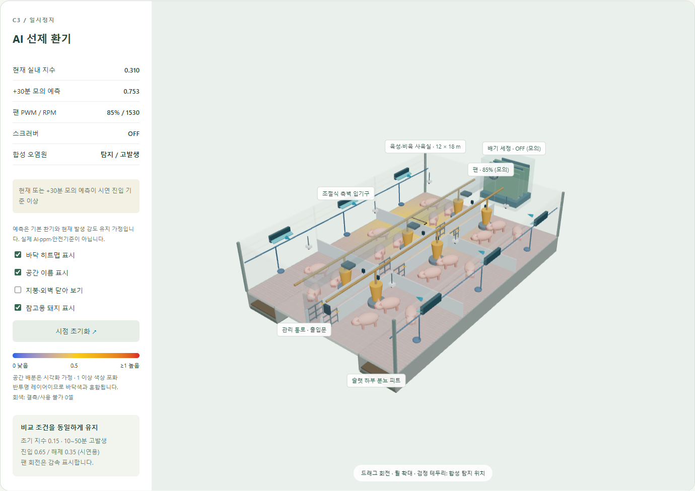
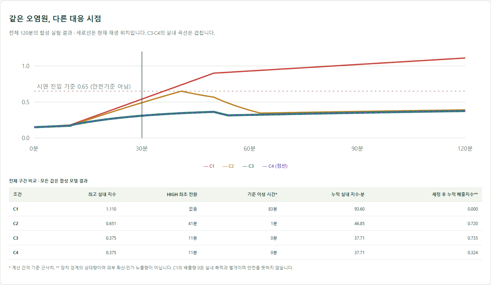
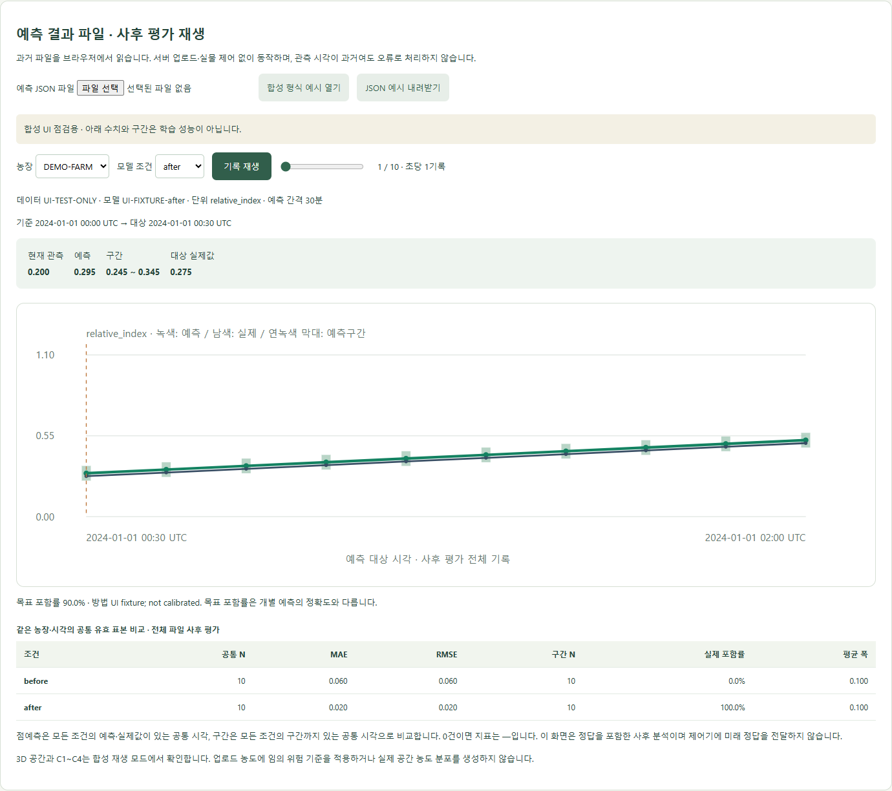

# 아기데지 — 시뮬레이터 공동 회의

**2026.10.07 20:00 · 제안서 제출 10.15 · 시뮬레이터 담당 공유 자료**

## 1. 현재 상태

핵심 연구는 **다중 농장 전이학습과 예측 신뢰도**, 시연은 시뮬레이터로만 진행한다. 데이터 확보·학습·제안서 작성은 각 담당자가 진행하며, 오늘까지 확보한 자료로 학습을 시작한다. 시뮬레이터는 모델 학습과 병렬로 준비한다.

| 완료 | 현재 범위 |
| --- | --- |
| 3D 돈사·히트맵 | 돈방·통로·급이/급수·피트·입기·덕트·팬·스크러버. 실제 농장 복제가 아닌 구조 개념 모형 |
| C1~C4 합성 실험 | 재생·정지·배속·시간 이동, 장치 상태, 조건별 그래프 |
| FastAPI 연결 | 합성 데이터 수신, 단위·좌표·시각·결측 검증, 오류·재연결 처리 |
| 예측 파일 재생·신뢰도 비교 | JSON 읽기·시각/단위 검증·결측 처리, 농장·모델 조건 선택, 점예측·예측구간·실제값 표시, 공통 표본의 오차·포함률·구간 폭 계산 |
| 팀원 체험 | 설치 없이 접속하는 임시 HTTPS 링크. 합성 시나리오·파일 재생 제공, 개인별 브라우저에서 실행 |
| 검증 | JavaScript 15개·Python 4개 테스트 통과, 빌드 성공. 파일 읽기·결측·오류·재생·모바일 확인 |

**아직 없는 것:** 실제 학습 결과 연결과 실데이터 성능 검증. 아래 캡처는 실제 앱 화면이지만 수치·구간은 모두 합성 예시다.

## 2. 현재 화면과 의미

### 돈사 내부와 장치 상태

*C3의 모의 30분 화면. 왼쪽은 지수·팬·스크러버 상태, 오른쪽은 돈사 구조와 바닥 히트맵이다.*

히트맵은 전체 지수를 가정된 공간 분포로 배분한 표시이며 CFD·위치별 실측 농도가 아니다. 드래그/휠로 시점을 조작하고 지붕·이름표·히트맵을 켜고 끌 수 있다.

### C1~C4 가상 제어 비교

**왜 실험을 바꿨는가?** 기존 C1~C4는 ‘환기를 하는가, 민가 쪽으로 배기하는가, 탈취탑을 켜는가’를 비교했다. 내부 제어로 범위를 좁힌 뒤에는 민가·지형·풍향을 재현하는 대신 **같은 오염원에서 언제 환기를 강화하는가**를 비교하도록 바꿨다. 고정된 입기·배기 계통을 두고 팬 출력을 조절하며, 다중 농장 예측 모델의 제어 활용을 설명하는 보조 시연으로 사용한다.

*같은 합성 발생원을 사용한 120분 결과. 표의 수치는 실제 농장 저감 성능이 아니다.*

| 조건 | 기존 외부 실험 | 현재 내부 제어 비교 |
| --- | --- | --- |
| C1 | 환기 OFF | OFF 유지. 오염원이 축적되는 가상 스트레스 조건 |
| C2 | 민가 방향 배기 | 현재 지수가 기준을 넘은 뒤 환기를 강화하는 사후 대응 |
| C3 | 비민가 방향 배기 | +30분 모의 예측 등을 기준으로 환기를 먼저 강화하는 선제 대응 |
| C4 | 민가 방향 배기 + 탈취탑 | C3와 동일한 선제 환기 + 배출 공기 세정 |

내부 제어안도 구조에 맞춰 두 가지를 구체화했다. **C2~C4는 기본 환기를 유지하다 HIGH로 전환**하므로 ‘환기 자체의 유무’보다 ‘강화 시점’을 비교한다. 완전 OFF는 C1에만 둔다. **C4의 스크러버는 배출 공기를 처리하고 실내로 재순환하지 않으므로**, 같은 환기 제거계수의 C3보다 실내가 더 빨리 회복하도록 설정하지 않았다. 따라서 C3·C4 실내 곡선은 겹치고 C4의 추가 효과는 배출측에서만 비교한다. 실제 풍량·압력손실은 아직 보정하지 않았다.

C2↔C3는 대응 시점 비교, C1은 스트레스 참고, C4는 배출 처리 보조 조건이다. 이 합성 실험 결과를 실제 모델의 전이학습 성능이나 실농장 저감 효과로 해석하지 않는다.

### 예측 결과 파일과 신뢰도 비교

*합성 UI 점검 파일을 읽은 화면. before/after는 조건 선택 기능을 확인하기 위한 이름이며 전이학습 개선을 입증한 결과가 아니다.*

파일에서 농장·조건을 선택하면 관측값, 점예측, 구간을 표시한다. MAE/RMSE는 조건 간 **공통 유효 시각**으로, 포함률·평균 폭은 구간까지 있는 공통 시각으로 계산한다. 목표 포함률과 실제 포함률을 구분하며, 구간·정답이 없으면 지표는 —로 표시한다.

이 화면은 미래 정답을 포함한 **사후 평가**다. 실제 과거 관측값을 가상 팬 조작으로 바꾸지 않는다. 3D 장치 시연과 예측 성능 비교는 서로 다른 모드다.

## 3. 구성과 사용법

- **합성 시연:** 합성 계산 → 브라우저 직접 재생 또는 FastAPI → 3D·히트맵·장치 상태.
- **모델 결과 확인:** 저장된 예측 JSON → 파일 검증 → 농장/조건 선택 → 시계열·구간·비교 지표. 파일은 브라우저 안에서 처리하며 서버 업로드나 추론 서버가 필요 없다.

**[팀원 시뮬레이터 체험하기](https://speakers-grocery-wallpaper-bought.trycloudflare.com)** — 설치 없이 접속해 상단 **데이터 모드**에서 합성 시나리오 또는 예측 결과 파일을 선택한다. 파일 예시가 필요하면 ‘합성 형식 예시 열기’를 누른다. 각자의 조작·선택 파일은 다른 팀원의 화면과 동기화되지 않는다.

주소를 아는 사람이 접속할 수 있는 임시 체험 링크다. 실행 PC와 공유 프로세스가 켜져 있어야 하며, 터널을 다시 시작하면 주소가 바뀐다. 선택한 JSON은 각자의 브라우저에서 처리하고 FastAPI 서버·작업 폴더는 이 링크로 제공하지 않는다. [임시 링크 안내](https://developers.cloudflare.com/tunnel/get-started/quick-tunnels/)

| 모드 | 조작·주의점 |
| --- | --- |
| 브라우저 합성 재생 | C1~C4·시간·속도 선택. 시나리오 변경은 0분 초기화, 시간 이동은 정지 |
| FastAPI 합성 재생 — 개발 PC 전용 | [로컬 화면](http://127.0.0.1:4173/)과 API 서버에서 사용. 팀 체험 링크에는 이 메뉴가 없음 |
| 예측 결과 파일 | JSON 선택 또는 ‘합성 형식 예시 열기’. 농장·모델 조건·기록 위치 선택. ‘JSON 예시 내려받기’로 형식 전달 가능 |

현재 파일 규격은 JSON, 5MB/20,000행 이하다. 과거 관측 시각을 그대로 보존하며 실시간 API의 ‘10초 경과’ 판정을 적용하지 않는다. CSV 결과는 실제 컬럼을 받은 뒤 변환한다.

## 4. 오늘 확정할 연결 사항

모델 학습은 바로 진행하고 **점예측 결과부터 먼저 전달**한다. 시뮬레이터 때문에 구간 산출이나 학습 완료를 기다릴 필요는 없다.

| 확인할 내용 | 현재 제안 | 회의 기록 |
| --- | --- | --- |
| 인계 담당·첫 샘플 시각 | 담당 1명, 10/08 소량 샘플 목표 | 담당: ___ / 시각: ___ |
| 결과 식별·단위 | 농장 ID, 모델/전이 조건, 모델 버전, 단위, 기준·예측 대상 시각 | 확정값: ___ |
| 구간·평가 결과 | 하한·상한·목표 포함률·구간 산출법, 대상 실제값. 없는 항목은 null | 제공 항목/시점: ___ |

현재값·점예측도 인계 파일에 포함한다. JSON 예시는 연결 가능한 형식이며 모델 담당자의 학습 코드에 이 형식을 강제할 필요는 없다. 다른 출력 형식은 어댑터로 맞춘다. 신뢰도 방법과 실제 성능 수치는 모델 담당 결과를 사용한다.

## 5. 회의 후 시뮬레이터 일정

| 시점 | 작업·완료 기준 |
| --- | --- |
| **10/08~09** | 받은 파일의 컬럼·시간·단위 매핑, 실제 점예측 연결. 미수령 시 현재 기능 유지 |
| **10/10~11** | 실제 전이 전후·예측구간 결과 검증. 누락·시각 불일치·비교 표본 확인 |
| **10/12~13** | 연결 범위 고정, 실제 결과/합성 시연 구분 점검, 확정 화면·구현 범위를 제안서 담당에게 전달 |
| **10/14~15** | 실행본 백업·재실행 확인·필수 오류 수정. 새 기능 추가 중단 |

결과가 점예측까지만 나오면 그 범위로 연결하고, 결과가 없으면 합성 시제품임을 명시한다. 다른 담당자의 데이터 확보·학습·원고 일정은 여기서 대신 확정하지 않는다.

## 6. 확장 — 필요 / 여유 시 / 불필요

### 필요

| 남은 작업 | 진행 조건 | 다음 작업 |
| --- | --- | --- |
| 실제 모델 출력 연결 | 농장/조건 ID, 단위·시각을 포함한 실제 샘플. CSV라면 헤더 포함 | 기존 재생 규격으로 변환하고 결측·시각 매핑 확인 |
| 실제 전이 전후·구간 결과 검증 | 동일 평가 구간의 예측·실제값, 구간 하한/상한·목표 포함률·산출법 | 공통 표본 지표를 모델 담당 결과와 대조하고 확정 화면 캡처 |
| 실제 농도와 3D 위험도 연결 | ppm→색상 범위/기준과 공간 배분 가정 합의 | 현재 시계열·지표 화면의 결과를 3D 표시와 연결. 정밀 공간 예측으로 표현하지 않음 |

### 여유 시

| 항목 | 진행 조건 |
| --- | --- |
| 지표 CSV·실험 이력 저장 | 실제 결과 연결 후 필요하면 추가. 현재 JSON은 파일로 보관 가능 |
| 비전 오염 표식·위치별 위험도 | 같은 돈사/시각의 탐지·좌표 자료 확보 시 |
| 그래프 확대·발표용 화면·번들 최적화 | 핵심 연결 완료 후 남은 시간에 수행 |

### 불필요 — 이번 제출·시연 범위

실물 센서 설치·장치 통신, 하드웨어 축소모형, 외부 민가·기상·확산/CFD, 모델 재생을 위한 별도 실시간 추론 서버, 로그인·다중 사용자 관리. 현재 필요한 예측 검증을 지연시키므로 이번에는 추가하지 않는다.
