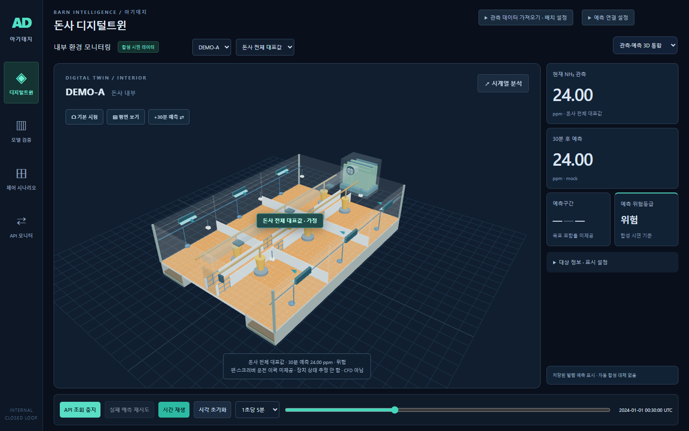

# 서비스 화면 개편

기존의 설명·표가 이어지는 페이지를 **3D 작업 공간 중심 화면**으로 변경했다.

- PC: 돈사 3D, 현재 농도·30분 예측·구간·위험등급, 하단 Replay를 한 화면에 배치.
- 공간 조작: 기본 시점, 평면 보기, 현재/예측 레이어 전환을 3D 안에서 바로 실행.
- 분석: ‘시계열 분석’ 버튼으로 그래프·대상 실제값 비교를 별도 창에서 확인. 닫기 버튼 또는 Esc로 복귀.
- 설정: 상단에서 데이터 가져오기·API 설정, 우측에서 대상 정보·표시 설정을 필요할 때 펼침.
- 모바일: 3D → 수치 → 재생 조작 순으로 재배치.

화면 구성은 `src/service.css`, 동작은 `src/TwinPanel.jsx`에 있다. 실제 예측·출처·결측 처리 규칙을 유지하며, 실시간 센서 연결이나 실제 운전 상태를 만들어 표시하지 않는다.

검증: JavaScript 34개 테스트 및 프로덕션 빌드 통과. PC 1440×900에서 페이지 세로 스크롤 없이 주 화면 표시 확인. 기존 3D 번들 크기 경고는 유지된다.

Chrome·실제 FastAPI 통합 검증도 통과: 분석 창 열기/Esc 닫기, 평면/기본 시점, 현재/예측 전환, 되감기·결측·통신 오류 및 재시도·늦은 응답 차단 확인. 모바일 가로 넘침 없음, JavaScript 화면 오류 0건.
