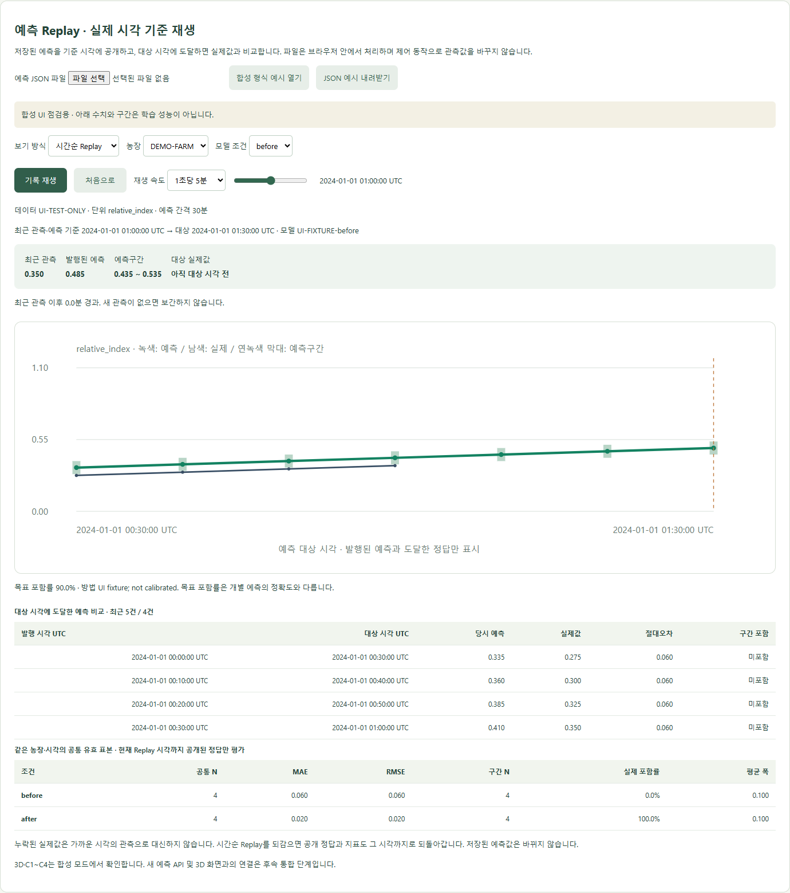

# 고도화 2단계 보고 — 실제 시간 기준 Replay

2026.10.11 · 상태: 완료

**예측 파일을 실제 시각대로 재생하고, 예측 대상 시각에 도달한 뒤 정답과 비교하도록 바꿨다.** 기존에는 1초마다 다음 행으로 이동하며 미래 실제값까지 보여 줬지만, 이제 시간순 Replay와 전체 사후 평가를 선택한다.

## 무엇이 달라졌나

| 기능 | 화면에서의 동작 |
| --- | --- |
| 실제 시간 재생 | 관측이 7분·20분 간격으로 있어도 그 간격을 유지한다. 배속은 1초당 1/5/10/30분이다. |
| 정답 지연 공개 | t에 발행한 예측은 바로 표시하고, t+30 실제값은 해당 시각부터 표시한다. 그래프 축과 지표에도 미래 정답을 쓰지 않는다. |
| 예측·실제값 비교 | 대상 시각에 도달한 최근 5건의 당시 예측·실제값·절대오차·구간 포함 여부를 보여 준다. 지표는 공개된 전체 유효 표본으로 계산한다. |
| 되감기·초기화 | 시각을 앞으로 되돌리면 정답과 지표도 다시 숨긴다. 저장된 예측 자체는 바꾸지 않는다. |
| 전체 사후 평가 | 전체 파일의 정답과 지표를 확인하는 별도 보기다. Replay로 돌아가면 현재 재생 시각의 공개 범위를 다시 적용한다. |
| 결측·일관성 | 없는 정답을 보간하거나 근처 값으로 대신하지 않는다. 같은 농장·시각의 현재값과 정답이 서로 다르면 파일을 거부한다. |

재생 범위는 마지막 예측 발행 시각이 아니라 **마지막 예측 대상 시각까지**다. 따라서 끝부분 예측도 정답과 비교할 수 있다. 시간 이동·농장/조건 변경 시 정지하며, 다른 탭으로 전환하거나 마지막 시각에 도달해도 자동 정지한다.

## 화면과 간단한 사용법

합성 예시의 60분 화면이다. 90분 대상 예측까지 발행됐지만 실제값과 지표에는 60분까지 도달한 4건만 들어간다. 수치와 구간은 UI 점검용이며 모델 성능을 나타내지 않는다.

1. 프로젝트 폴더에서 `npm.cmd run preview`로 빌드 화면을 연다. 소스를 바꿨다면 먼저 `npm.cmd run build`를 실행한다.
2. **데이터 모드 → 예측 결과 파일 → 합성 형식 예시 열기**를 선택한다.
3. **시간순 Replay**에서 재생·정지·배속·시간 막대를 조작한다. 처음에는 평가 표본이 0건이고 30분부터 비교가 시작된다.
4. **전체 사후 평가**를 선택하면 전체 지표를 볼 수 있다. 다시 Replay로 돌아가거나 ‘처음으로’를 눌러 공개 범위를 확인한다.

예시의 첫 예측은 00:00에 발행된 00:30 대상 0.335다. 00:29:59까지 실제값은 숨겨지고 00:30부터 0.275가 공개되어 절대오차 0.060을 계산한다. 파일 단위는 상대지수이며 ppm이 아니다.

## 코드 역할과 조정할 값

| 파일 | 역할·조정 지점 |
| --- | --- |
| `src/replayClock.js` | 재생 범위·시간 이동 계산, 시점별 값 공개, 도달한 정답 비교. 화면과 독립된 공통 로직이다. |
| `src/useReplayClock.js` | 실제 경과 시간을 재생 시각으로 바꾼다. 기본 배속은 `useState(5)`, 화면 갱신 간격은 100ms다. |
| `src/ReplayPanel.jsx` | 조작부·그래프·비교 표. 배속 목록 `[1, 5, 10, 30]`과 최근 비교 표시 수 `slice(-5)`를 조정할 수 있다. |
| `src/replayData.js` | 파일·관측 일관성 검사와 공통 표본 지표 계산. 예측 간격은 파일의 `horizon_minutes`와 시각 차이를 함께 검증한다. |

100ms는 UI 갱신 주기일 뿐 관측 주기가 아니다. 배속과 갱신 주기를 바꿔도 파일의 예측값·관측 시각·평가 기준은 달라지지 않는다.

## 검증 결과와 다음 단계

- **JavaScript 23개 테스트 통과:** 기존 15개와 시간 경계·불규칙 간격·되감기·결측·관측 일관성 등 신규 8개.
- **빌드 성공.** 기존 번들 크기 경고는 남아 있으며 실행 오류는 아니다.
- **브라우저 확인 통과:** 29분 59초/30분 경계, 그래프·지표 정답 숨김, 사후 평가 전환, 배속·정지·끝 자동 정지, 결측/잘못된 파일, 날짜가 다른 농장 전환, 390px 모바일 가로 넘침 검사, 기존 3D 모드 복귀. 페이지 JavaScript 오류 없음.
- 테스트 환경의 로컬 연결 문제는 서버와 브라우저를 같은 테스트 실행 환경에서 구동하여 해결했다. 검증용 서버는 종료했다. 백엔드는 변경하지 않았으며 Python 테스트를 이번 단계에서 재실행하지 않았다.

이번 단계는 **기존 `replay-1` 저장 예측 파일의 시간순 재생**이다. 실제 파일의 학습 시점·데이터 누출 여부 자체를 검증한 것은 아니다. 1단계의 새 Predictor API 호출·관측 데이터 연결과 3D 화면 통합은 **3단계**에서 진행한다.
