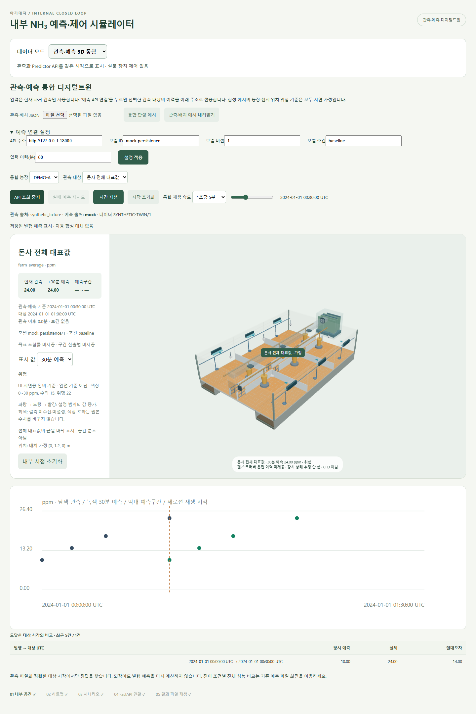

# 고도화 3단계 보고 — 관측·예측·3D 통합

2026.10.11 · 상태: 완료

**관측 파일 → Predictor API → 3D 돈사·정보 패널·시계열을 연결했다.** 농장과 관측 대상을 선택하면 하나의 재생 시각으로 현재 NH₃, 30분 예측, 예측구간, 위험등급을 확인한다. 실제 학습모델 대신 1단계 Mock을 연결해 검증했다.

## 구현 내용

| 기능 | 동작 |
| --- | --- |
| 농장·센서 선택 | 목록 또는 3D 센서 표식을 클릭한다. 선택 변경 시 시각과 API 연결을 초기화해 다른 대상의 응답이 섞이지 않는다. |
| 현재·예측 표시 | 관측값과 API 점예측·구간·출처·모델 버전을 함께 표시한다. 바닥/센서 색을 현재값 또는 30분 예측으로 전환한다. |
| 공간 표현 | 전체 대표값은 균일한 바닥 색으로, 개별 센서는 해당 위치의 표식으로 표시한다. 측정하지 않은 바닥 분포는 회색으로 남긴다. |
| 위험·예측구간 | 설정된 경계값으로 등급을 표시하고 구간이 경계를 걸치는지 알린다. 기준이 없으면 ‘기준 미설정’, 값이 없으면 ‘값 없음’으로 표시한다. |
| API Replay | 재생 시각까지의 예측을 순차 조회하며 각 요청에는 해당 기준 시각 이하의 관측만 보낸다. 성공한 예측은 같은 선택·설정 안에서 재사용한다. |
| 정답 비교 | 대상 시각에 도달하면 정확히 같은 시각의 관측과 비교한다. 정답이 없으면 보간하지 않는다. |
| 오류 처리 | 시간 초과·실패·불일치 응답은 표시에서 제외한다. 사용자가 재시도할 수 있으며 Mock으로 자동 대체하지 않는다. |

API 조회가 재생보다 느리면 해당 시각의 예측은 대기 상태로 남는다. 과거 예측을 최신 예측으로 바꿔 표시하지 않는다. 재생을 되감으면 미래 정답·그래프도 다시 숨긴다. 새 파일·농장·대상·모델 설정으로 바꾸면 이전 예측 캐시는 초기화한다.

## 실제 화면



합성 예시의 00:30 화면이다. 현재 관측 24 ppm, Mock의 01:00 예측 24 ppm이 연결되어 있다. 아래 비교 표는 00:00에 발행한 예측 10 ppm과 00:30 관측 24 ppm을 대조한다. Mock은 구간을 만들지 않으므로 구간은 —이다. 캡처의 API 포트 18000은 검증용이며 일반 실행 기본값은 8000이다.

예시의 위험 경계 15/22 ppm은 **UI 테스트를 위한 임의 값이며 실제 안전 기준이 아니다.** 실제 관측 파일에는 합성 기준을 적용할 수 없도록 검사한다. 실측 위치가 없으면 ‘배치 가정’으로 표시한다. 팬·스크러버는 구조만 보여 주며, 운전 이력이 없으므로 상태를 추정하지 않는다.

## 직접 실행하기

프로젝트 폴더 `outputs/barn-simulator`의 첫 번째 터미널:

```powershell
$env:PREDICTOR_MODE = 'mock'
.\backend\.venv\Scripts\python.exe -m uvicorn backend.app:app --host 127.0.0.1 --port 8000
```

두 번째 터미널:

```powershell
npm.cmd run preview
```

빌드본을 제공한다. 코드 변경 후에는 `npm.cmd run build`를 먼저 실행한다.

1. 화면의 **데이터 모드 → 관측·예측 3D 통합**을 선택한다.
2. **예측 API 연결**을 누른다. 현재·과거 관측 이력을 설정된 API 주소로 전송한다. 연결 버튼을 누르기 전에는 전송하지 않는다.
3. 재생하거나 시간 막대를 이동한다. 기본 DEMO-A는 전체 대표값이며 DEMO-B는 개별 센서 예시다.
4. **표시 값**을 현재 관측/30분 예측으로 전환한다. 센서 표식을 클릭해 대상을 바꿀 수도 있다.

실제 모델을 붙일 때는 [모델 연결 안내](../../backend/PREDICTOR_GUIDE.md)에 따라 백엔드 공급자를 교체하고, 화면의 **예측 연결 설정**에서 모델 ID·버전·조건·입력 이력 길이를 맞춘다. 설정 적용 후 API 연결을 다시 누른다. 학습모델의 전처리·변수 명세는 모델 담당자에게 받아 어댑터에 반영한다.

## 변경할 값과 파일

[관측·배치 JSON 예시](../../examples/twin-SYNTHETIC.json)를 내려받아 수정할 수 있다. `twin-1` 형식은 여러 관측 시계열과 배치·표시 설정을 묶는다. 기존 `replay-1` 예측 결과 파일과 구분한다.

| 항목 | 변경 효과 |
| --- | --- |
| `farm_id`, `subject_id`, `label` | 농장·관측 대상의 식별자와 화면 이름 |
| `position: [x,y,z]`, `position_basis` | 센서/대표값 표식 위치와 가정/제공 좌표 구분. 좌표는 돈사 내부 범위로 검사 |
| `scope` | `farm`: 전체 대표값의 균일 바닥, `sensor`: 해당 지점만 표시 |
| `unit`, `observation_source`, `records` | 단위·출처·시간순 NH₃/부가 입력. 결측은 null |
| `policy` | 미정이면 null. 설정 시 min/max 색상 범위, warning/danger 경계, basis 근거, demo 여부 |
| 화면의 모델 설정 | API 기본 주소, 모델 ID/버전·조건, 입력 이력 길이(기본 60분). 인증정보는 백엔드에만 설정 |
| `src/config.js` | 기존 돈사 크기·카메라·색상 설정 유지 |

`src/twinData.js`가 입력·응답 검사와 위험 표시를, `src/useTwinPredictions.js`가 요청·취소·예측 보관을, `src/TwinPanel.jsx`가 통합 화면을 담당한다. 기본 장식 센서 표식은 통합 모드에서 숨겨 실제로 연결된 대상으로 오해하지 않도록 했다. 카메라 모형은 구조 참고이며 비전 모델 출력은 아직 연결하지 않았다.

## 검증과 다음 단계

- **JavaScript 30개 테스트 통과:** 기존 23개 + 계약·미래 입력 차단·공간 범위·위험 기준·정답 시각 신규 7개.
- **빌드 성공:** 기존 번들 크기 경고는 남아 있다.
- **브라우저 + 실제 FastAPI 검증 통과:** 값 갱신, 되감기 캐시 재사용, 3D 표식 선택, 결측 입력, 기준 미설정, 구간 경계 표시, API 실패/재시도, 선택 변경 후 늦은 응답 무시, 모바일 390px 가로 넘침 검사, 기존 C1~C4 화면 복귀. 페이지 JavaScript 오류 없음.
- 예측구간 UI 검증에는 별도로 명시한 합성 응답을 사용했다. 실제 모델 구간 보정·성능을 검증한 것은 아니다. 백엔드 코드는 변경하지 않았으며 Python 단위 테스트는 이번 단계에서 재실행하지 않았다.

다음은 **4단계: 전이 조건·모델 버전·평가 구간을 갖춘 농장별 신뢰도 비교 화면 정리**다. 실제 모델·실측 위치·위험 기준은 아직 미확정이며, 공급자/데이터/표시 설정으로 연결할 수 있는 상태까지 준비했다.
