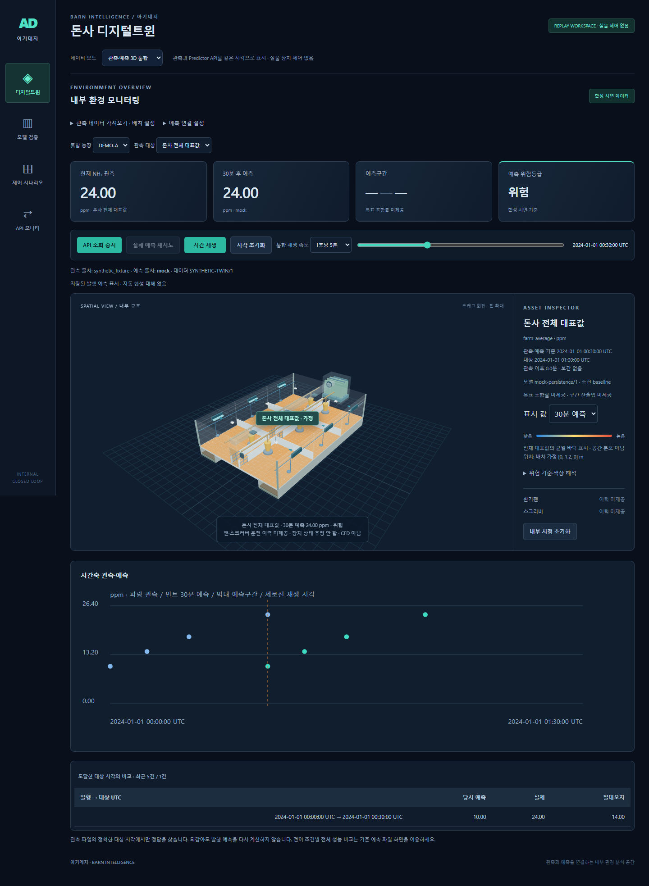
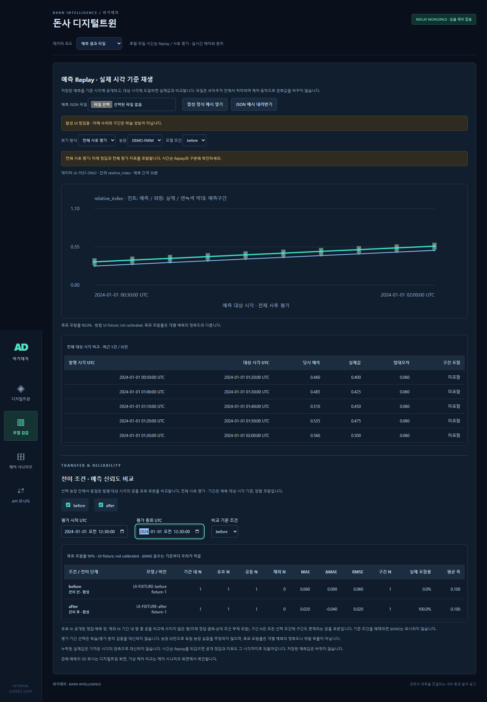

# 4단계 보고 — 운영 대시보드와 전이·신뢰도 비교

2026.10.11 · 실제 학습 모델 연결 전, 합성 자료와 Mock API로 검증

## 무엇이 달라졌나

- **디지털트윈 중심 화면:** 첫 화면을 3D 통합으로 변경. 현재 NH₃·30분 예측·예측구간·위험등급을 상단 카드로, 돈사 내부를 중앙에, 선택 대상과 장치 정보를 우측에 배치했다.
- **작업별 메뉴:** 디지털트윈 / 모델 검증 / 제어 시나리오 / API 모니터. 데이터 가져오기와 연결 설정은 접어서 주 화면에 집중할 수 있다.
- **농장별 조건 비교:** 평가 대상 기간(UTC), 비교 조건, 기준 조건을 선택한다. 모델 버전과 전이 단계, MAE·RMSE·기준 대비 ΔMAE, 예측구간 포함률·평균 폭을 표시한다.
- **비교 근거 공개:** 기간 내 행 수, 유효 예측·정답 쌍, 공통 표본 수, 제외 수, 구간 공통 표본 수를 함께 표시한다. Replay를 되감으면 미래 정답은 지표에서도 빠진다.

## 직접 확인하는 순서

1. 기존 방법으로 FastAPI와 프론트를 실행한다. 기본 디지털트윈 화면의 **예측 연결 설정**에서 API 주소·모델 정보를 확인한 뒤 **예측 API 연결**을 누른다. 이 버튼은 선택 대상의 과거 관측 이력을 설정한 서버로 보낸다.
2. 농장·관측 대상을 고르고 **시간 재생** 또는 시간 막대를 움직인다. 30분 후 실제 기록이 공개되면 아래 비교표에 당시 예측과 오차가 표시된다.
3. **모델 검증 → 합성 형식 예시 열기 → 전체 사후 평가**로 이동한다. 화면 아래에서 평가 기간·조건·기준을 바꾸며 지표를 확인한다. 두 농장 선택은 [전이 비교 합성 파일](../../examples/transfer-SYNTHETIC.json)을 불러와 확인한다.

## 해석과 변경 가능한 설정

| 항목 | 변경 위치 / 의미 |
| --- | --- |
| 화면 색·간격·반응형 배치 | `src/dashboard.css` |
| 돈사 크기·기본 카메라 | `src/config.js`의 BARN / VIEW |
| 센서 위치·대표 범위·위험 기준 | 관측·배치 JSON의 position / scope / policy |
| 모델 버전·전이 단계 | 예측 Replay JSON 행의 model_version / transfer_stage. 미제공도 허용하지만 같은 조건 안에 여러 버전을 섞으면 거부 |
| 평가 기간 | 화면의 시작·종료 UTC. 예측 대상 시각 기준, 양끝 포함 |

ΔMAE가 음수면 선택 기준보다 오차가 작다. 포함률은 구간 폭·표본 수와 함께 해석한다. 목표 포함률은 개별 예측의 정확도가 아니다. 농장별로 평가하며 농장들을 합친 평균은 만들지 않는다.

두 농장 예시는 동일 수열을 복제한 UI 점검 자료다. 독립 농장 데이터나 전이학습 성능 증거가 아니다. 화면의 합성 출처·가정된 위치·미수신 예측·장치 이력 미제공 표시를 유지했다. 바닥은 대표 위험도의 시각화이며 물리 확산 계산이 아니다. 실제 모델 연결 전에는 현장 검증된 운영 시스템으로 주장하지 않는다.

## 검증과 다음 작업

- JavaScript **34개 테스트 통과**: 지표 계산, 평가 기간, 공통 표본 부재, 미래 정답 차단, 모델 버전 혼합 거부 등.
- 프로덕션 빌드 통과. 기존 3D 번들 크기 경고는 남아 있으며 실행 오류는 아니다.
- Chrome + 실제 로컬 FastAPI 검증: 예측 수신·정답 비교·되감기 캐시·센서 선택·결측·위험 기준 미설정·구간 경계·API 실패/재시도·늦은 응답 차단·기존 C3 표시 통과. 화면 JavaScript 오류 0건.
- 평가 화면의 ΔMAE, 기간 변경 후 공통 N, 잘못된 기간 안내 확인. PC/390px 모바일 캡처를 확인했고 페이지 가로 넘침 없음.

다음은 **5단계 오류·가상 제어 통합 검증**, 이후 **6단계 실행·인계 패키징**이다. 실제 모델 출력·전처리 규칙·평가셋 정보·위험 기준은 담당자 제공 후 연결 및 대조한다.
