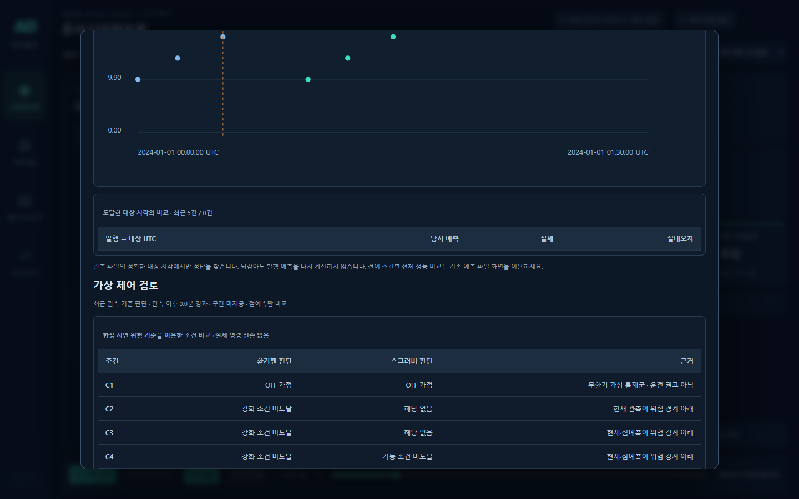

# 5단계 — 오류 처리·가상 제어 검토

2026.10.12

## 이번 단계의 결과

디지털트윈의 **시계열 분석 → 가상 제어 검토**에서 최근 관측과 그 시점의 예측으로 C1~C4 조건을 비교한다. 서비스 주 화면은 그대로 유지했다.

| 조건 | 표시하는 판단 |
| --- | --- |
| C1 | 무환기 통제군의 OFF 가정. 운전 권고 아님 |
| C2 | 현재 관측이 설정된 위험 경계 이상이면 강화 검토 |
| C3 | 현재 또는 30분 예측이 위험 경계 이상이면 강화 검토 |
| C4 | C3와 같은 팬 판단 + 강화 시 배출측 스크러버 가동 검토 |

현재 관측이나 위험 기준이 없으면 C2~C4를 판단 보류한다. 예측 실패·미수신·입력 부족·음수 출력이면 C3/C4를 보류하며, 유효한 현재값이 있는 C2 판단은 별도로 유지한다. 점예측이 낮아도 구간이 위험 경계를 걸치면 별도 검토로 표시한다. 구간 미제공은 **점예측만 비교**라고 명시한다.

이 표는 한 시점의 조건 검토다. 장치 명령·RPM·연속 운전 이력을 만들지 않고, 과거 관측을 변경하지 않는다. 최소 유지시간·해제 기준이 적용된 연속 제어는 기존 **제어 시나리오**에서 확인한다. C4가 C3보다 실내 농도를 더 낮춘다고 표시하지 않는다.

## 확인 방법과 변경 위치

1. 디지털트윈에서 예측 API를 연결하고 재생 시각을 선택한다.
2. **시계열 분석**을 열어 아래의 가상 제어 검토표를 확인한다.
3. 모델이 구간을 제공하지 않거나 예측에 실패했을 때의 보류·신뢰도 문구를 확인한다.

판단 규칙: `src/controlReview.js` / 화면: `src/ControlReview.jsx`. 경계는 관측·배치 파일의 `policy.danger`를 사용하며 별도의 ppm 값을 하드코딩하지 않았다. 여기서 사용한 위험 경계는 가상 비교용이며, 실제 제어 정책 승인이나 구간 보정 품질 검증을 대신하지 않는다.

## 검증

- JavaScript 38개 테스트 통과: C1~C4 기존 연속 제어, 신규 조건 검토, 결측·오류·경계·미래 정답 차단 포함.
- Python 15개 테스트 통과: Mock/File/HTTP 공급자, 입력·응답 계약, 데이터 로더 포함. 임시 파일 권한 오류가 발생한 최초 실행은 작업 폴더를 임시 경로로 지정해 재실행했다.
- 프로덕션 빌드 통과. 기존 번들 크기 경고와 Python 테스트 라이브러리의 사용 중단 예정 경고는 남아 있다.

## 다음 단계

**6단계: 로컬 실행·종료와 모델 연결 인계 패키징.** 실행 스크립트, 설정 예시, 모델 담당자 연결 안내, 최종 재실행 절차를 정리한다. 실제 학습 모델의 품질 검증은 출력과 평가셋 정보를 받은 뒤 진행한다.

브라우저 통합 검증 통과: 실제 로컬 FastAPI 조회, 과거 이력만 전송, 되감기 캐시, 대상 정답 비교, 센서 전환, 미설정 기준, 구간 경계, 503 재시도, 늦은 응답 차단, 요청 도중 중지, 잘못된 응답 거부, 8초 시간 초과 후 복구, 모바일 가로 넘침 없음. 화면 JavaScript 오류 0건.

