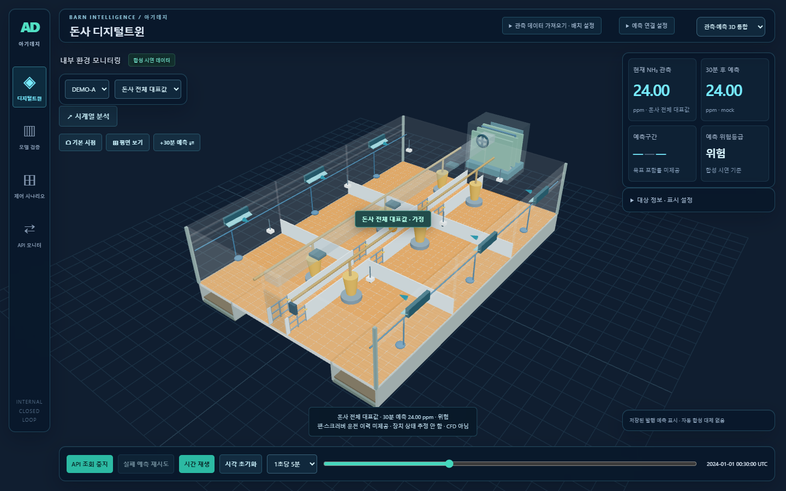
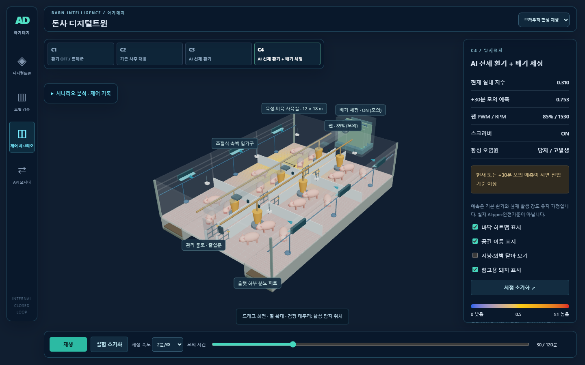

# UI 리뉴얼 1단계 — 전체화면 캔버스·다크 플로팅 패널

이번 단계는 화면 구조와 스타일만 수정했다. C1~C4 계산, NH₃ 값, 예측 계약, 기존 차트, 돈사 오브젝트와 조명은 유지했다. 합성 모드의 배경색만 관측 모드와 같은 다크 톤으로 맞췄다.

## 변경 파일

| 파일 | 역할 |
| --- | --- |
| `src/immersive.css` | 화면 전체 Canvas, 반투명 패널, 테두리·블러·강조색, PC/모바일 배치 |
| `src/main.jsx` | 기존 CSS 뒤에 immersive.css를 로드해 이번 디자인을 우선 적용 |
| `src/App.jsx` | 모바일 패널 표시 버튼, 기존 시나리오 분석·기록을 담는 접이식 패널, 합성 화면 배경색 |

3D가 있는 관측·예측 / C1~C4 / API 모드에 적용한다. 모델 검증은 기존 파일·표 분석 전용 화면을 유지한다.

## 핵심 코드와 역할

```css
.app-shell:not(.mode-file) .viewport {
  position: fixed;
  inset: 0;
  width: 100vw;
  height: 100vh;
  height: 100dvh;
  z-index: -1;
}
```

`fixed`와 `inset: 0`으로 Canvas 컨테이너를 브라우저 가장자리에 고정한다. 기존 좌우 열이 Canvas 폭을 나누지 않도록 workspace는 `display: contents`로 처리했다. R3F는 컨테이너 크기를 읽어 렌더링 영역을 갱신한다. 루트의 `isolation: isolate`와 패널의 z-index가 3D/플로팅 UI의 표시 순서를 정한다. 패널 밖의 빈 공간은 Canvas가 직접 마우스 입력을 받는다.

```css
:root {
  --hud-bg: rgb(8 22 40 / 76%);
  --hud-border: rgb(99 211 242 / 24%);
  --hud-blur: 18px;
  --hud-cyan: #77ecff;
  --hud-gap: 20px;
  --hud-right-width: 280px;
}
```

- `--hud-bg`의 마지막 비율: 낮추면 배경이 더 비치고, 높이면 글자 가독성이 올라간다.
- `--hud-blur`: 패널 뒤 3D의 블러 강도. 성능이 부담되면 8~12px부터 확인한다.
- `--hud-border`: 차가운 시안 테두리. 진하게 만들수록 패널 윤곽이 강조된다.
- `--hud-cyan`: 핵심 수치·포커스 강조색.
- `--hud-gap`, `--hud-right-width`: 우측 패널의 여백·폭. 모바일 값은 파일 아래 미디어 쿼리에서 별도 조정한다.

공통 패널에 `background`, `backdrop-filter: blur(...) saturate(130%)`, 얇은 테두리와 그림자를 함께 적용했다. 블러가 지원되지 않더라도 어두운 바탕과 테두리는 유지된다. 밝은 글로우를 과도하게 넣지 않고, 다음 단계에서 실제 장치 가동 상태와 연결할 예정이다.

## 화면 조작

- 좌측: 모드 선택, 농장·대상, 시점·표시 전환.
- 우측: 현재값·예측값·구간·위험등급과 대상 정보.
- 하단: 기존 시간 재생·속도·API 연결 조작.
- C1~C4의 기존 그래프·제어 기록: **시나리오 분석 · 제어 기록**을 펼쳐 확인.
- 모바일의 **접기 / 패널** 버튼: 데이터·카메라 상태를 바꾸지 않고 패널만 숨기거나 복원.





## 검증 및 다음 단계

프로덕션 빌드 통과. Chrome에서 1440×900, 1280×720, 390×844의 Canvas 경계가 화면과 일치하고 페이지 가로·세로 넘침이 없음을 검증했다. 빈 공간 마우스 회전, 패널 조작, API 값 수신, C4 선택·시간 이동, 분석 창, 모바일 패널 숨김·복원 통과. 화면 JavaScript 오류 0건.

다음 단계는 **도넛·게이지·상태 배지 등 데이터 위젯**이다. 3D 조명·장치 가동 하이라이트는 그 뒤에 진행한다. 이번 변경은 소스와 로컬 dist에 반영했으며 기존 6단계 전달 ZIP은 리뉴얼 전 보관본이다.
