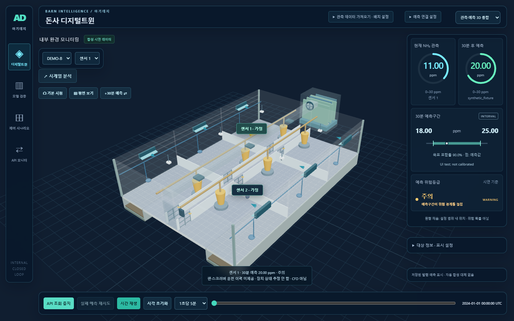
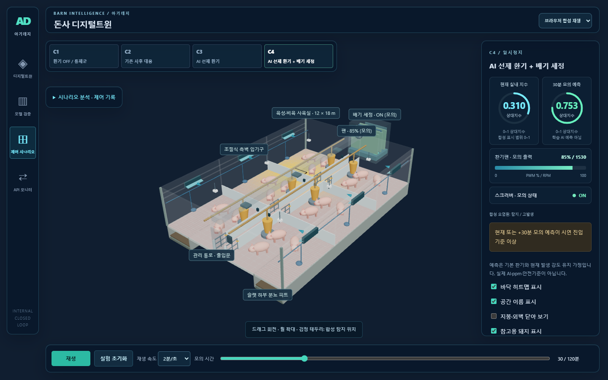

# UI 리뉴얼 2단계 — 데이터 위젯

## 결과

- 현재 NH₃와 30분 예측: **원형 게이지**. 중앙에 원래 값과 단위를 표시하고, 아래에 표시 범위를 명시한다.
- 예측구간: **하한–상한 막대와 점예측 표식**. 목표 포함률과 산출법을 함께 표시한다. 미제공이면 빈 상태로 남긴다.
- 위험 상태: **NORMAL / WARNING / DANGER / UNKNOWN 배지**. 기존 위험등급 결과를 받아 색상·문구만 바꾼다. 구간이 경계를 걸치는 경우 별도로 알린다.
- 합성 C1~C4: **팬 PWM 막대·RPM 수치·스크러버 ON/OFF 배지**. 기존 frame의 계산값을 그대로 사용한다.



위 캡처의 예측구간은 브라우저 검증용 합성 응답이다. 실제 모델 성능·보정된 구간이 아니다.



## 코드 역할과 조절 방법

| 파일 | 역할 |
| --- | --- |
| `src/DataWidgets.jsx` | RingGauge, IntervalWidget, RiskBadge, FanGauge, DeviceBadge 화면 구성 |
| `src/widgetData.js` | 원형 채움 비율·구간 막대 위치 계산. 원본 데이터 변경 없음 |
| `src/widgets.css` | 원 크기·선 두께·강조색·간격·모바일 배치 |
| `src/TwinPanel.jsx`, `src/App.jsx` | 기존 데이터 값을 각 위젯에 전달 |

```jsx
<RingGauge
  label="현재 NH₃ 관측"
  value={observed.nh3}
  min={series.policy?.min}
  max={series.policy?.max}
  unit={series.unit}
  testId="twin-current"
/>
```

`value`는 원래 관측값, `min/max`는 원형이 사용하는 표시 범위다. 범위를 모르면 숫자만 유지하고 원은 점선으로 표시한다. 값이 없으면 0으로 만들지 않는다. 범위를 넘는 값은 원의 채움만 포화시키고 수치는 원래 값으로 유지한다. 채움 비율은 정확도나 위험 확률이 아니다.

직접 조절할 스타일:

- `.ring-face`의 width/height: 원 크기. PC 기본 104px, 모바일 68px.
- `.ring-track, .ring-fill`의 stroke-width: 원의 선 두께. 기본 5.
- `.tone-green`의 `--widget-accent`: 예측값 강조색. 현재값은 기존 `--hud-cyan`을 사용한다.
- `.state-normal / warning / danger`의 `--status-color`: 상태 배지 색상. 등급 계산은 바뀌지 않는다.
- `.fan-gauge`의 height와 그 안의 linear-gradient: 팬 출력 막대 두께·색상.

## 검증과 다음 단계

JavaScript **41개 테스트**와 프로덕션 빌드 통과. 추가 검증은 0/결측 구분, 범위 초과, 음수 구간 하한, 폭 0 구간, 구간 밖 점예측 위치다. 기존 C1~C4 제어 검증도 통과했다.

Chrome에서 실제 로컬 API 값, 구간 미제공·합성 구간, WARNING 및 경계 통과 문구, C4 팬 85%/1530 RPM·스크러버 ON을 확인했다. 1440×900, 1280×720, 390×844에서 전체화면 Canvas, 조작·패널 숨김·복원을 검증했고 화면 오류 0건이다.

3D 조명·돈사 오브젝트·제어 수식·기존 시계열 차트는 변경하지 않았다. 다음은 **3단계: 다크 씬 조명과 장치 가동 하이라이트**다. 현재 소스와 dist에 반영했으며 기존 전달 ZIP은 리뉴얼 전 보관본이다.
