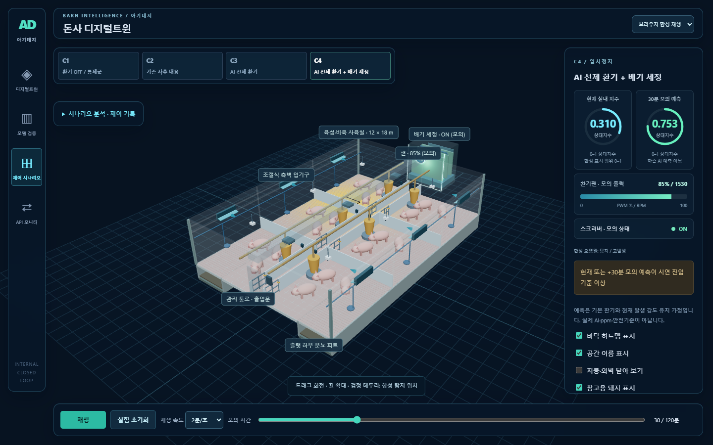
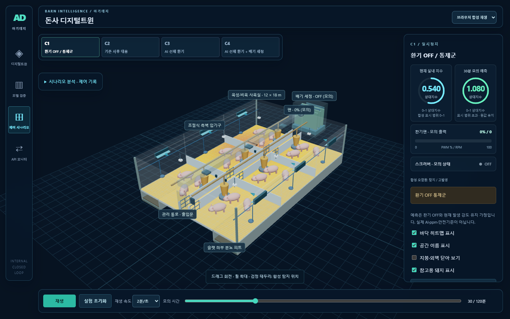

# UI 리뉴얼 3단계 — 다크 씬·장치 가동 하이라이트

## 적용 결과

- 공통 SceneEnvironment로 관측·예측 및 C1~C4 화면의 다크 배경·바닥 그리드·조명을 통일했다.
- 중립색 주 조명과 푸른 측후면 조명으로 돈방, 배관, 슬랫, 돼지와 장치의 형태를 구분한다. 히트맵 값·색상 기준은 유지했다.
- 팬이 가동 중이면 시안 링, 스크러버가 ON이면 민트 외곽 스트립과 작은 주변광을 표시한다.
- 장치 값이 없거나 OFF이면 가동 효과를 생성하지 않는다. 관측 모드에는 장치 이력이 없으므로 가동 효과가 없다.





## 코드 역할

| 파일 | 역할 |
| --- | --- |
| `src/SceneEnvironment.jsx` | 다크 배경, 주 조명·측후면 조명, 공통 그리드 |
| `src/DeviceHighlight.jsx` | 팬 링·스크러버 스트립, 반투명 halo와 주변광 |
| `src/sceneStyle.js` | 시각 설정과 가동 상태 판정 |
| `src/Barn.jsx` | 기존 장치 위치에 하이라이트를 연결 |

```js
fanActive: typeof frame?.rpm === 'number'
  && Number.isFinite(frame.rpm) && frame.rpm > 0,
scrubberActive: frame?.scrubberOn === true,
```

이 판정은 모의 frame의 상태를 읽기만 한다. 팬 RPM·제어 조건·NH₃ 계산은 바꾸지 않는다. C2~C4의 기본 환기에서도 팬이 돌면 링이 켜진다. 스크러버는 C4의 가동 조건을 만족할 때만 강조된다. 재생 정지는 선택한 시점의 장치 상태를 유지하므로 강조도 유지하며, 팬 날개 회전만 멈춘다.

## 직접 조절할 값

`src/sceneStyle.js`의 SCENE_STYLE:

| 변수 | 현재값 | 효과 |
| --- | --- | --- |
| background | #071321 | 배경 톤 |
| gridMajor / gridMinor | #24495b / #142c3e | 바닥 그리드 밝기 |
| ambient / hemisphere | 0.65 / 0.85 | 전체와 상하 주변광 |
| keyLight / rimLight | 2.1 / 1.6 | 주 조명과 푸른 측후면 조명 |
| fanColor / scrubberColor | #55dbff / #66f1b9 | 가동 강조색 |
| emissiveIntensity | 1.8 | 발광 재질 강도 |
| haloOpacity | 0.12 | 반투명 외곽광 강도 |

Bloom 후처리 라이브러리는 추가하지 않았다. 발광 재질·반투명 겹침·국소 조명으로 효과를 구현하고 기존 demand 렌더링을 유지한다. 그리드와 발광은 시각적 안내이며 외부 확산장·실측 조도·CFD 결과가 아니다.

## 검증

- JavaScript 43개 테스트와 프로덕션 빌드 통과. 기존 제어·Replay·신뢰도 검증 포함.
- 추가 테스트: 미확인/0/음수 RPM 및 유효하지 않은 스크러버 상태에서 발광 없음, C1/C3/C4 독립 상태 연결, 원본 frame 불변.
- 실제 로컬 FastAPI를 사용하는 Chrome 검증: 값 수신·구간 표시·C1/C3/C4 선택·시간 이동·재생/정지·되감기·전체화면·모바일 패널 조작 통과. 화면 오류 0건.
- C3/C4는 동일한 실내 지수를 유지하며 C4만 스크러버가 강조됨을 확인했다. PC 1440×900 / 1280×720, 모바일 390×844에서 확인했다.

계획한 시각 리뉴얼 1~3단계를 완료했다. 실제 모델·데이터 연결과 성능 검증은 기존 MODEL_HANDOFF.md 절차를 따른다.
